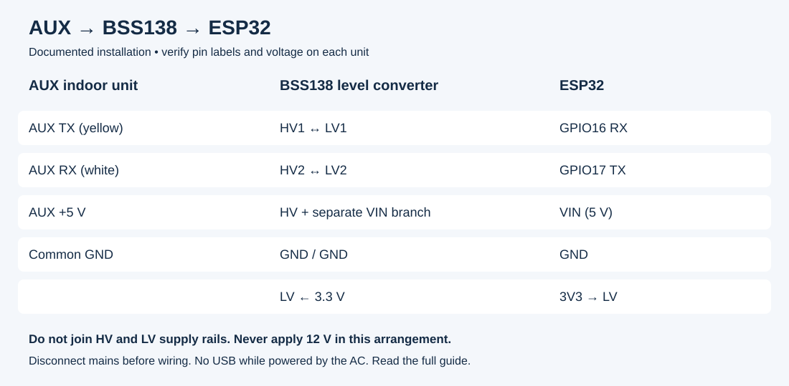
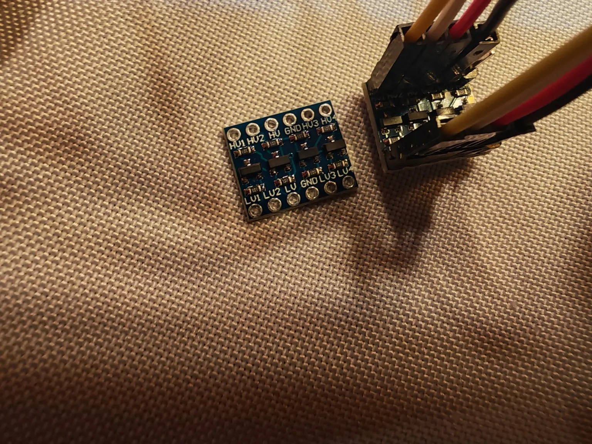
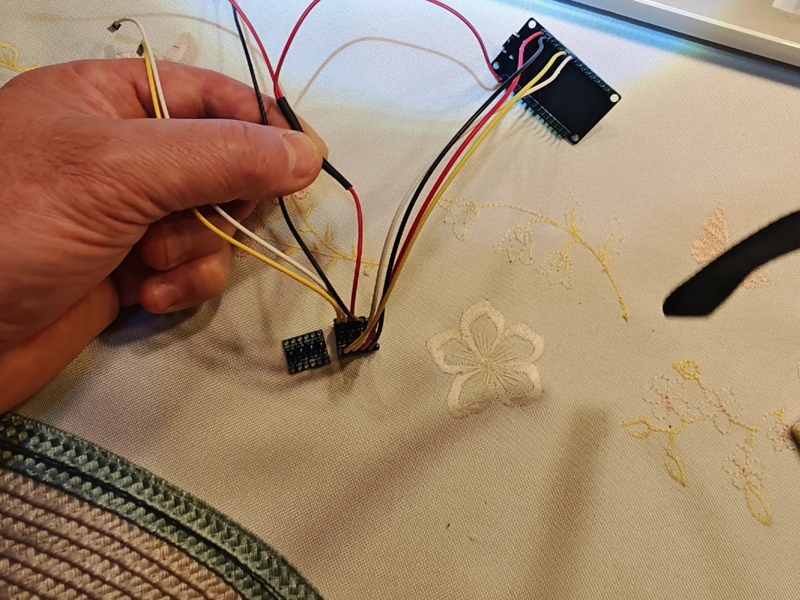
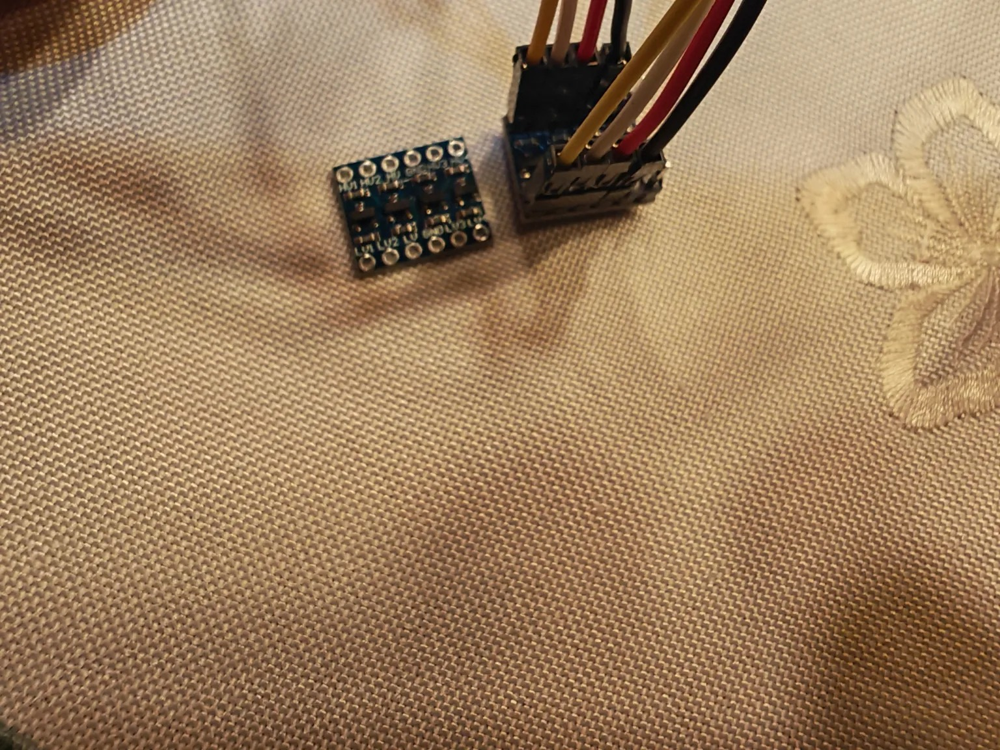

# AUX ESP32 → Home Assistant

AUX Console Pro klíma helyi vezérlése ESP32 és ESPHome segítségével, a [GrKoR AUX AC komponensére](https://github.com/GrKoR/esphome_aux_ac_component) építve.

Telepítés és eredeti útmutatók: **Hajcsák Attila, Magyarország**. [English README](README.md)

## Működő konfiguráció

**A megoldás három azonos AUX Console Pro AMCO-H12/4R3DA-2 klímámon működik. A külön YAML-fájl a működő hálószobai konfigurációmon alapul, a titkos adatokat `!secret` hivatkozások helyettesítik.**

A PDF-ek korábbi konfigurációs példát tartalmaznak; az aktuális változat az [aux-ac.example.yaml](aux-ac.example.yaml) fájlban található. A nyilvános példán külön fordítási vagy hardveres teszt nem történt a közzétételkor. A tényleges ESPHome- és Home Assistant-verzió, illetve a tesztelt komponens-commit még nincs rögzítve. A komponens változó master ágára hivatkozunk.

## Útmutatók és fájlok

- [Magyar PDF](AUX_ESP32_Integracios_utmutato_HU.pdf)
- [Angol PDF](AUX_ESP32_Integration_Guide_EN.pdf)
- [Bekötési táblázat](wiring.md)
- [Aktuális ESPHome YAML](aux-ac.example.yaml)
- [Titkos adatok sablonja](secrets.example.yaml)

## Dokumentált hardver

- AUX Console Pro AMCO-H12/4R3DA-2 beltéri egység, 2022.
- Eredeti modul: AUXWIFI0001-A1 / BroadLink BL3353-P.
- ESP-WROOM-32 fejlesztőpanel, CH340 USB-C.
- Négycsatornás BSS138 szintillesztő.
- Eredeti, ötérintkezős csatlakozó, négy bekötött vezetékkel.

Működik a helyi, kétirányú vezérlés, a hőmérséklet, az üzemmód és a ventilátorsebesség állítása a gyártói felhő nélkül. Más modellek kompatibilitása nincs igazolva.

## Használat

1. Másold az aux-ac.example.yaml tartalmát a helyi ESPHome-konfigurációdba; több eszköznél adj egyedi eszközneveket.
2. A secrets.example.yaml fájlt másold secrets.yaml névre, és helyben töltsd ki az adatokat. Az aux_api_key helyére érvényes, eszközönként egyedi ESPHome API-kulcs kell.
3. Ellenőrizd a pontos panelt, a lábkiosztást és a konfigurációt az általad használt ESPHome-verzióval.
4. Csak ellenőrzés után fordíts és telepíts.

A valódi secrets.yaml fájlt soha ne töltsd fel. A .gitignore Git használatakor segít kizárni azt; kézi böngészős feltöltésnél magadnak kell kihagynod.

## OTA-kompatibilitás

Az üres OTA encryption blokk szándékos: az API titkosítási kulcsát használja. A titkosított OTA ESPHome 2026.9.0-tól érhető el. Régebbi, már telepített firmware frissítésénél kövesd a [hivatalos átállási útmutatót](https://esphome.io/components/ota/esphome/#enabling-encryption-on-an-existing-device).

## Biztonság

Szerelés előtt áramtalanítsd a klímát. Az áramkör nem feltétlenül galvanikusan leválasztott: klímáról táplált ESP32-re ne csatlakoztass USB-t. A leírt bekötés 5 V-os VIN/HV és 3,3 V-os LV tápágat használ; 12 V nem adható rájuk, a HV és LV tápágakat tilos közvetlenül összekötni. Ellenőrizni kell a táp terhelhetőségét, a feszültséget és a lábkiosztást minden készüléken.

Az opcionális VIN-kapcsoló nem biztonsági leválasztó: az adatvezetékeken visszatáplálás lehetséges. A teljes PDF-et olvasd el a szerelés előtt.

## Szerelési fotók

A képek az eredeti magyar útmutatóból származnak. A számozás nem szerelési sorrend. Elsődleges referencia a lábfelirat és a bekötési táblázat.

## Kérdések, segítség

Ha kérdésed van, nyiss egy [Issue-t](https://github.com/hajcsaka/aux-esp32-home-assistant/issues). Sok időmbe telt, mire összeállt a működő megoldás; szívesen segítek, amiben tudok. Írd meg a klíma pontos típusát és az ESPHome-verziót, de jelszót vagy API-kulcsot ne ossz meg.

## Szerzők és felhasználás

A hardveres megvalósítás és az eredeti dokumentáció Hajcsák Attila munkája. Az AUX ESPHome-komponens GrKoR projektje, saját licencével; a komponens forráskódját ez a repó nem tartalmazza.

Az útmutatókhoz és fotókhoz a szerző még nem választott külön felhasználási licencet. A nyilvános elérhetőség önmagában nem jelent nyílt forrású licencet.
