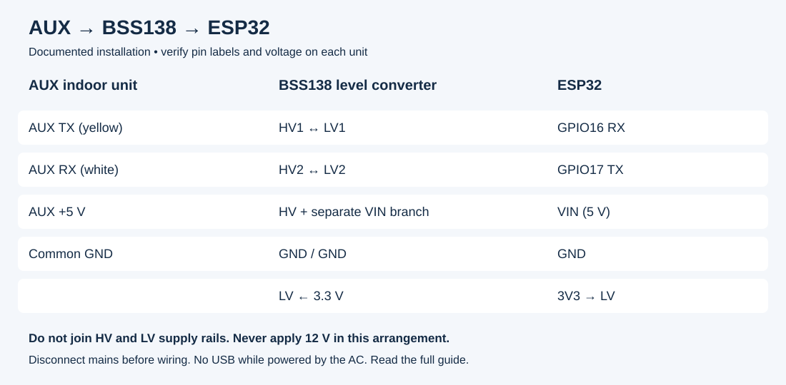
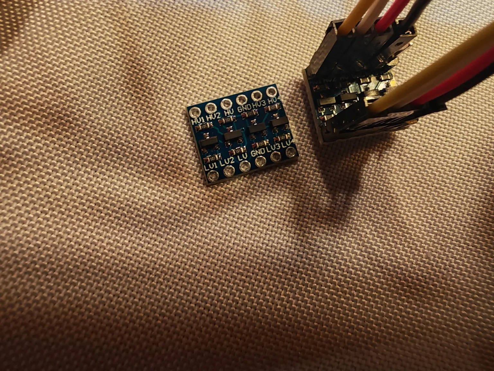
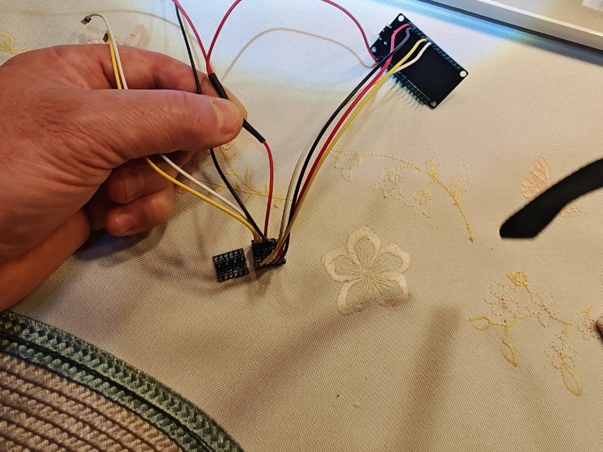
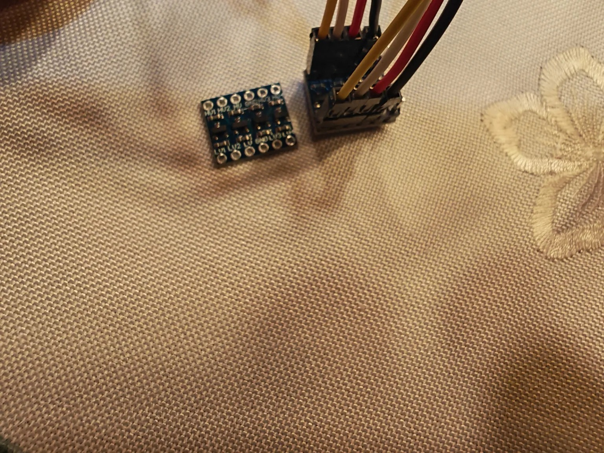
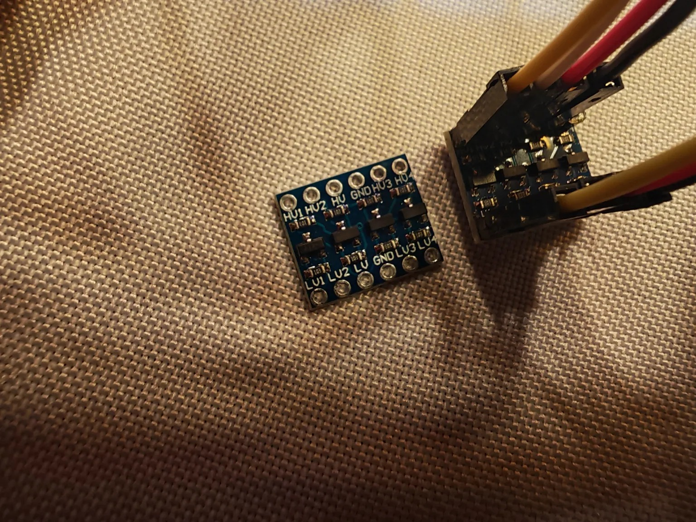

# AUX ESP32 → Home Assistant

Local control of an AUX air conditioner using ESP32, ESPHome and the [GrKoR AUX AC component](https://github.com/GrKoR/esphome_aux_ac_component).

Installation and documentation by **Attila Hajcsák, Hungary**. This repository documents a specific installation; it is not a replacement for the upstream component.

[Magyar leírás](README.hu.md)

## Installation guides

- [English guide (PDF)](AUX_ESP32_Integration_Guide_EN.pdf)
- [Magyar útmutató (PDF)](AUX_ESP32_Integracios_utmutato_HU.pdf)

Both guides include the wiring diagram, assembly photographs, configuration example and commissioning notes.

## Documented hardware

| Item | Model |
| --- | --- |
| Indoor unit | AUX Console Pro AMCO-H12/4R3DA-2 (2022) |
| Original Wi-Fi module | AUXWIFI0001-A1 / BroadLink BL3353-P |
| Controller | ESP-WROOM-32 development board, CH340 USB-C |
| Level converter | Four-channel BSS138 bidirectional module |
| Connection | Original five-pin connector, four populated wires |

The installer reports local control, bidirectional UART communication, temperature, mode and fan-speed adjustment without the original Wi-Fi module or manufacturer cloud.

## Configuration status

**The YAML in the PDFs is a reconstructed example, not a verified export of the deployed configuration.** Compare it with your hardware and validate it with your ESPHome version before flashing. Tested ESPHome/Home Assistant versions and an upstream commit have not yet been recorded. The example references the upstream `master` branch, which can change.

Credentials are represented by `!secret` references. Keep real Wi-Fi passwords and API keys in a local `secrets.yaml`; never commit them.

Compatibility is documented only for the hardware above. Connector pinout, wire colours, voltage and available supply current must be checked on each unit.

## Electrical safety

Disconnect the air conditioner from mains before wiring. The circuit may not be isolated from mains: do not connect USB while the ESP32 is powered by the air conditioner. The documented arrangement uses 5 V at VIN/HV and 3.3 V at LV; do not apply 12 V or join the HV and LV supply rails. All grounds are common in this arrangement. See the full guide before assembly.

The optional VIN switch may not fully power down the ESP32 because data lines can backfeed power. It is not an isolation or safety switch.

## Magyar összefoglaló

A projekt egy AUX Console Pro klíma helyi Home Assistant-vezérlésének megvalósítását mutatja be ESP32 és ESPHome segítségével. A magyar PDF tartalmazza a bekötést, a szerelési fotókat és az üzembe helyezés leírását.

**A PDF-ben szereplő YAML rekonstruált példa:** használat előtt ellenőrizni kell a tényleges konfigurációhoz és az alkalmazott ESPHome-verzióhoz képest. A leírt bekötés nem tekinthető minden AUX-modellre érvényesnek. A biztonsági előírásokat a teljes útmutatóban olvasd el.

## Credits

- Hardware installation and guides: Attila Hajcsák.
- AUX ESPHome component: [GrKoR/esphome_aux_ac_component](https://github.com/GrKoR/esphome_aux_ac_component), distributed separately under its own license.

When reporting compatibility, include the exact indoor-unit model, controller board, ESPHome version and upstream component revision. Remove credentials and personal network details from any logs you share.

## Files you can use directly

- [Wiring diagram](wiring.svg) / [wiring table](wiring.md)
- [ESPHome example](aux-ac.example.yaml) — reconstructed from the guide, not compile-tested or hardware-verified here
- [Secrets template](secrets.example.yaml) — placeholders only

Copy `aux-ac.example.yaml` to your local ESPHome configuration, and copy `secrets.example.yaml` to `secrets.yaml`. Fill in your own credentials and a valid ESPHome API encryption key. Validate the configuration with your installed ESPHome release before flashing. No firmware binary is supplied.

## Assembly photographs

Extracted from the Hungarian guide. File numbering is for reference and does not indicate assembly order. Pin labels and the wiring table take precedence over wire colours.

## Reuse and licensing

An explicit license for the original guides and photographs has not yet been selected by the author. Public availability alone is not an open-source license. The upstream component retains its own license; its source code is not included here.
